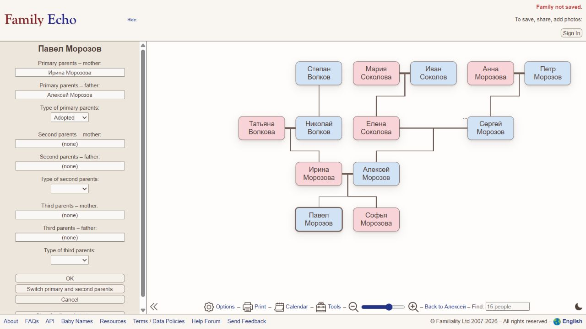

# Исследование приложений родословной и выбор направления продукта

Дата исследования и проверок: 14 ноября 2026 года. Дата сохранения в базе знаний проекта: 14 ноября 2026 года.

Статус: сохраненный отчет исследования. Рекомендация о проверке продуктового направления предварительная; спрос, реальные оплаты и решение о разработке не подтверждены. Ограничения практических испытаний приведены в разделе 2.

Примечание от 17 ноября: предыдущий абзац описывает состояние на дату исследования. Позднее владелец отдельно разрешил локальную разработку семейного архива; реализован локальный кандидат. Текущий состав и открытая приемка устройств находятся в [едином плане](../plans/2026-11-15-rodoslovnaya-mvp-pwa.md) и [сводке состояния](../knowledge/CURRENT-STATE.md). Коммерческий спрос этим не подтвержден; предложения отчета не заменяют текущие требования.

Цены, версии, условия оплаты, правовые требования и доступность сервисов являются сведениями на дату проверки. Перед новым решением их нужно проверить повторно.

Источник: полный отчет из чата проекта. Сохранено по прямой просьбе пользователя «сохрани исследование в бз проекта». Численные условия будущих экспериментов и оценки трудоемкости остаются предложениями.

В отчете GEDCOM означает формат обмена генеалогическими данными; HTML - формат веб-страниц, в том числе для автономного просмотра; JSON и XML - форматы структурированных данных; PDF - формат документов. ZIP обозначает формат архива файлов, API - программный интерфейс для взаимодействия приложений.

[Карта исследования](INDEX.md) | [База знаний проекта](../knowledge/INDEX.md) | [Карта проекта](../INDEX.md)

Вики-ссылки: [[research/INDEX|Карта исследования]], [[knowledge/CURRENT-STATE|Текущее состояние]], [[plans/2026-11-15-rodoslovnaya-mvp-pwa|Действующий план]].

## 1. Краткий вывод и рекомендация

**Начинать разработку универсального приложения для родословной пока не обосновано.** Редакторы дерева, семейные архивы, книги, совместная работа и перенос данных уже представлены на рынке. Основная неопределенность - достаточно ли существующие решения удобны для конкретной аудитории и готова ли она платить за улучшение.

Рекомендую первым проверить направление **«Передаваемый семейный выпуск»**:

> Один организатор из уже собранных фотографий, рассказов и сведений о родственниках готовит понятный семейный выпуск, который близкие открывают без специальной программы. Вместе с ним сохраняется проверяемый комплект исходных файлов и источников.

Первую проверку лучше провести как ограниченную услугу на существующих программах. Разрабатывать приложение имеет смысл, если подтвердятся одновременно:

- повторяющаяся проблема;
- преимущество перед существующим способом;
- реальные оплаты;
- приемлемые затраты на подготовку и поддержку.

Публичные свидетельства подтверждают отдельные затруднения передачи и сохранения материалов. **Распространенность проблемы, готовность переходить и готовность платить пока не установлены.**

Для собственно ведения родословной уже сейчас разумно испытать Древо Жизни, Gramps или RootsMagic; для совместного семейного архива - Famiry, Gramps Web или webtrees с учетом требований к сопровождению.

## 2. Методика, дата исследования, охват и ограничения

**Дата проверки источников и практических испытаний - 14 ноября 2026 года**, если отдельно не указана дата публикации.

Проведены три раздельных исследовательских разбора:

1. Потребности и пользовательские проблемы.
2. Конкуренты и существующие альтернативы.
3. Жизнеспособность: распространение, оплата, расходы и ограничения.

Результаты сопоставил отдельный агент. Основанием рекомендации стали качество свидетельств и стоимость следующей проверки. Совпадение мнений агентов само по себе доказательством не считалось.

Основная карта содержит 30 продуктовых семейств, подробное сравнение - 12. Версии одного продукта объединены, различия настольной, мобильной и веб-версий отмечены отдельно.

Обозначения далее:

- **Проверено** - наблюдалось в доступной среде.
- **Документировано** - описано разработчиком; успешная работа не подразумевается.
- **Сообщение пользователя** - свидетельство конкретного случая.
- **Вывод / гипотеза** - результат анализа.
- **Не установлено** - информации или проверки недостаточно; это не означает отсутствия функции.

### Что проверено практически

Подготовлены вымышленная семья из 15 человек, семь семейных связок, два учебных источника, пять подписанных синтетических изображений, PDF-документ и рассказ. Отдельно создано дерево на 1000 человек.

| Продукт                                         | Фактически наблюдавшийся результат                                                                                                                                             | Что осталось непроверенным                                                                                                         |
| ----------------------------------------------- | ------------------------------------------------------------------------------------------------------------------------------------------------------------------------------ | ---------------------------------------------------------------------------------------------------------------------------------- |
| Family Echo, дополнительный контрольный продукт | Гостевой импорт 15 человек; читаемые кириллица и отчества; сохранение типа связи «усыновление»; отображение приблизительной даты. Импорт 1000 человек и поиск заданной персоны | Полный экспорт, перенос файлов и источников, повторный импорт, восстановление                                                      |
| Древо Жизни                                     | Официальный установщик с действительной подписью Genery LLC; установка и запуск **6.4, сборка 20261111**; корректная кириллица в предварительном просмотре GEDCOM              | Импорт не завершен: инструмент ненадежно управлял отдельным диалогом. Это ограничение испытания, не установленная ошибка программы |
| Gramps Web                                      | Вход в официальную общую демонстрацию; русский интерфейс; навигация к экспорту; отдельные варианты Gramps XML, GEDCOM, GEDCOM 7 и ZIP с медиа                                  | Импорт, редактирование, выгрузка с последующим восстановлением, синхронизация                                                      |
| Familio                                         | Открылись главная и регистрация с почтой и паролем                                                                                                                             | Учетная запись и дерево не создавались                                                                                             |
| Famiry                                          | Открылись главная, регистрация с почтой и официальный пример дерева                                                                                                            | В демонстрации видна панель, но полноценный просмотр графа не подтвержден; редактирование и выгрузка не проверены                  |
| FamilySpace                                     | Открылась регистрация: настоящие имя и фамилия, почта с подтверждением, проверка от робота                                                                                     | Регистрация, редактор и экспорт не проверены                                                                                       |

Остальные продукты исследованы по документации, магазинам и репозиториям. Устройства Android и Apple для испытаний не использовались; изолированный сервер webtrees не разворачивался. Новые учетные записи не создавались, платежи не выполнялись.

**Фактический российский регион выхода в сеть и регион учетных записей магазинов не подтверждены.** Открытие страницы исследовательским инструментом не засчитывалось как доказательство работы из России.

Вымышленные сведения не вносились в общие публичные деревья. Демонстрация Gramps Web использовалась только для чтения.

Пример проверенного сохранения усыновления после импорта:

Материалы для повторной проверки:

- [Полная матрица: 12 продуктов × 17 основных и 8 российских критериев](../competitor-matrix-2026-11-14.json).
- [Журнал практических проверок](../research-data/practical-checks-2026-11-14.json).
- [Описание тестовых данных и контрольные суммы файлов](../research-data/fixtures/manifest.json).

Полноценное испытание всех функций всех 12 продуктов не состоялось. Поэтому отчет дает документальное сравнение с ограниченной практической проверкой, а не сертификацию надежности или удобства.

## 3. Общая карта рынка

Включались решения, позволяющие вести родословную либо системно сохранять семейные материалы. Декоративные шаблоны деревьев, универсальные редакторы схем и архивные базы без собственного семейного архива не включались в основную таблицу.

Основная категория указана для удобства; многие продукты пересекают несколько категорий.

| №   | Продуктовое семейство                                                                                     | Основная категория                         | Платформы и назначение                                                  |
| --- | --------------------------------------------------------------------------------------------------------- | ------------------------------------------ | ----------------------------------------------------------------------- |
| 1   | **[Древо Жизни](https://genery.com/ru/)**                                                                 | Конструктор / исследовательский инструмент | Windows, macOS, Linux; локальная родословная                            |
| 2   | [Family Echo](https://www.familyecho.com/)                                                                | Конструктор                                | Веб; быстрое дерево и печать                                            |
| 3   | **[Family Gem](https://www.familygem.app/)**                                                              | Конструктор                                | Android; локальное дерево                                               |
| 4   | **[MacFamilyTree / MobileFamilyTree](https://www.syniumsoftware.com/macfamilytree)**                      | Конструктор / исследовательский инструмент | macOS, iPhone, iPad                                                     |
| 5   | [Ancestris](https://www.ancestris.org/index.html)                                                         | Конструктор                                | Windows, macOS, Linux; работа с GEDCOM                                  |
| 6   | [Ahnenblatt](https://www.ahnenblatt.com/)                                                                 | Конструктор                                | Windows; дерево, проверки и печать                                      |
| 7   | [КОРⱯ](https://apps.apple.com/ru/app/корɐ-семейное-древо/id6754966534)                                    | Конструктор                                | Найдена витрина Apple; дерево, воспоминания, голосовой ввод             |
| 8   | **[Famiry](https://famiry.ru/)**                                                                          | Семейный архив                             | Веб; дерево, биографии, материалы, совместная работа                    |
| 9   | [Семейные легенды](https://family-universe.ru/)                                                           | Семейный архив                             | Веб и мобильные приложения; вход временно недоступен по сообщению сайта |
| 10  | [FamilyAlbum](https://install.family-album.com/)                                                          | Семейный архив                             | Android, iOS; фото и видео, ограниченный просмотр через браузер         |
| 11  | [Storyworth](https://welcome.storyworth.com/)                                                             | Семейные рассказы                          | Вопросы, ответы родственника, итоговая книга                            |
| 12  | **[Remento](https://www.remento.co/)**                                                                    | Семейные рассказы                          | Голосовые истории, фотографии и книга                                   |
| 13  | **[Familio](https://familio.org/)**                                                                       | Генеалогическая платформа                  | Веб; дерево, люди, населенные пункты, исторические материалы            |
| 14  | **[FamilySpace](https://www.familyspace.ru/)**                                                            | Генеалогическая платформа                  | Веб; социальная сеть, дерево, файлы и архивные справочники              |
| 15  | **[MyHeritage / Family Tree Builder](https://www.myheritage.com/)**                                       | Генеалогическая платформа                  | Веб, мобильные приложения, настольный редактор                          |
| 16  | **[FamilySearch / Memories](https://www.familysearch.org/)**                                              | Генеалогическая платформа                  | Веб, Android, iOS/iPadOS; общее дерево и воспоминания                   |
| 17  | [Ancestry](https://help.ancestry.com/hc/en-us/articles/53933330564243-Creating-Trees-in-the-Ancestry-App) | Генеалогическая платформа                  | Веб, Android, iPhone/iPad; дерево и архивный поиск                      |
| 18  | [Geni](https://www.geni.com/)                                                                             | Генеалогическая платформа                  | Веб; совместное мировое дерево                                          |
| 19  | [Geneanet](https://en.geneanet.org/)                                                                      | Генеалогическая платформа                  | Веб; личные деревья, документы и сообщество                             |
| 20  | [WikiTree](https://www.wikitree.com/wiki/Help%3AThe_Free_Family_Tree)                                     | Генеалогическая платформа                  | Веб; общее дерево с источниками                                         |
| 21  | **[Gramps / Gramps Web](https://www.grampsweb.org/)**                                                     | Исследовательский инструмент               | Windows, macOS, Linux и собственный веб-сервер                          |
| 22  | **[RootsMagic](https://www.rootsmagic.com/rootsmagic/essentials)**                                        | Исследовательский инструмент               | Windows, macOS; локальная база и связи с платформами                    |
| 23  | [Family Tree Maker](https://www.mackiev.com/ftm/)                                                         | Исследовательский инструмент               | Windows, macOS; мобильный просмотр через FTM Connect                    |
| 24  | [Family Historian](https://www.family-historian.co.uk/)                                                   | Исследовательский инструмент               | Windows; мобильное приложение представлено как пробная версия           |
| 25  | [Legacy Family Tree](https://legacyfamilytree.com/)                                                       | Исследовательский инструмент               | Windows; источники, материалы и отчеты                                  |
| 26  | [Heredis](https://home.heredis.com/en/)                                                                   | Исследовательский инструмент               | Windows, macOS, мобильные приложения                                    |
| 27  | [Reunion / ReunionTouch](https://www.leisterpro.com/)                                                     | Исследовательский инструмент               | macOS, iPhone/iPad                                                      |
| 28  | **[webtrees](https://webtrees.net/)**                                                                     | Исследовательский инструмент               | Веб на собственном сервере                                              |
| 29  | [The Next Generation of Genealogy Sitebuilding](https://tngsitebuilding.com/)                             | Исследовательский инструмент               | Коммерческий семейный сайт на собственном сервере                       |
| 30  | [GeneWeb](https://geneweb.tuxfamily.org/wiki/GeneWeb)                                                     | Исследовательский инструмент               | Локальный или серверный браузерный интерфейс                            |

Жирным выделены 12 подробно рассматриваемых семейств.

Дополнительный контрольный поиск обнаружил новые предложения: [openom](https://github.com/openomhq/openom), [Tree-Monk](https://github.com/n1kozor/Tree-Monk), [Shijro](https://shijro.com/), [Roots](https://rootsfamily.org/), [VoiceMoir](https://apps.apple.com/ru/app/voicemoir-книга-жизни/id6804801109), [Kinly](https://apps.apple.com/ru/app/kinly-семейное-древо/id6783656197). Их зрелость, переносимость и российская пригодность подробно не проверялись. Они дополнительно показывают, что голосовые истории, локальное хранение и семейное дерево уже предлагаются в разных сочетаниях.

Поиск достаточен для сравнения основных способов решения задачи и требуемых платформ. **Полнота каталога рынка и исчерпание всех новых продуктов не утверждаются.**

Смежные решения следует рассматривать отдельно:

- **Архивные источники:** Яндекс Поиск по архивам, FamilySearch Records, Память народа, ОБД Мемориал, региональные архивы.
- **Сообщества:** ВГД и профильные группы.
- **Услуги:** генеалоги, оцифровка, восстановление фотографий, подготовка семейных книг.
- **ДНК-сервисы:** отдельный способ исследования родства со своими ограничениями.
- **Привычные заменители:** папки, внешние диски, облачные альбомы, мессенджеры и бумажные записи.

## 4. Сравнительная таблица продуктов

Таблицы ниже сокращены для чтения. Полная матрица по всем критериям находится в приложенном файле JSON. Заполненная ячейка со знаком «не установлено» не означает проверенную возможность.

### Основной сценарий, стоимость и переносимость

| Продукт             | Основная задача                                   | Стоимость и существенные ограничения                                                                         | Выход с данными                                                                                        |
| ------------------- | ------------------------------------------------- | ------------------------------------------------------------------------------------------------------------ | ------------------------------------------------------------------------------------------------------ |
| Древо Жизни         | Локальное исследование и печать                   | Бесплатно до 40 персон; лицензия версии 6 - от 2500 ₽                                                        | GEDCOM с папкой фотографий; собственный архив с оригиналами документов                                 |
| Familio             | Дерево, поиск людей и мест                        | Бесплатное дерево; Plus - 399 ₽/месяц или 3990 ₽/год                                                         | GEDCOM и материалы Диска - разные выгрузки; после подписки есть существенный риск недоступности файлов |
| Famiry              | Семейное дерево и архив                           | Публичная статья: 4400 / 6790 / 10 600 ₽ в год; текущий заказ не проверен                                    | Расширенные тарифы описывают копию в личное облако с файлами, GEDCOM и PDF                             |
| FamilySpace         | Семейная социальная сеть                          | Актуальная цена Premium не установлена                                                                       | GEDCOM описан старой справкой; полный перенос архива не подтвержден                                    |
| MyHeritage          | Дерево, совпадения, архивный поиск                | Basic: 250 персон и 500 МБ; покупки жителям России ограничены условиями                                      | GEDCOM содержит ссылки на фотографии; оригиналы требуют отдельной процедуры                            |
| FamilySearch        | Общее дерево, записи, воспоминания                | Бесплатно                                                                                                    | Выгрузка дерева и воспоминаний раздельна; простой штатный полный экспорт не подтвержден                |
| Gramps / Gramps Web | Подробное исследование и контроль данных          | Бесплатное ПО; сервер требует ресурсов и сопровождения                                                       | XML и медиа; GEDCOM не заменяет полную резервную копию                                                 |
| RootsMagic          | Подробная локальная база                          | Essentials бесплатно; цена полной версии различалась между извлечениями                                      | GEDCOM и файлы отдельно; резервирование медиа зависит от редакции                                      |
| webtrees            | Совместный семейный сайт                          | Бесплатное ПО; нужен сервер и администратор                                                                  | GEDCOM и документированные варианты выгрузки медиа                                                     |
| MacFamilyTree       | Локальное исследование и семейная работа на Apple | В найденной российской витрине: MacFamilyTree 2990 ₽, MobileFamilyTree 1290 ₽ по акции; покупка не проверена | GEDCOM 7; полнота переноса оригиналов требует испытания                                                |
| Family Gem          | Локальное дерево на Android                       | Бесплатная основа; Premium - $2,99, покупка через Google Play                                                | GEDCOM либо ZIP с GEDCOM и медиа                                                                       |
| Remento             | Голосовые истории и книга                         | $99 за первый год с книгой; дальнейшая подписка                                                              | Записи и PDF-книга выгружаются раздельно; выгрузка записей не включает фото и тексты                   |

Источники цен, ограничений и функций приведены в соответствующих карточках ниже.

### Сложные данные, совместная работа и сохранность

| Продукт             | Сложные связи и неопределенность                                                     | Совместная работа и история                                           | Без интернета и резервирование                                          |
| ------------------- | ------------------------------------------------------------------------------------ | --------------------------------------------------------------------- | ----------------------------------------------------------------------- |
| Древо Жизни         | Подробные события и поля; полнота сложных случаев не испытана                        | Совместное редактирование и общая история не подтверждены             | Локальная работа и собственный архив документированы                    |
| Familio             | Места и сведения о персонах; усыновление и противоречащие утверждения не установлены | Plus; история с ручным восстановлением изменений                      | Полная работа без сети не подтверждена                                  |
| Famiry              | Биографии и события; сложные исследовательские случаи не испытаны                    | Совместная работа; подробность прав требует проверки                  | Внешняя облачная копия документирована; работа без сети не подтверждена |
| FamilySpace         | Несколько браков описаны старой справкой                                             | Настройки видимости описаны; современная история изменений неизвестна | Не установлено                                                          |
| MyHeritage          | Развитая модель дерева; единый сложный сценарий не испытан                           | Семейные сайты; точные ограничения зависят от режима                  | Настольная программа и веб-функции различаются                          |
| FamilySearch        | Несколько супругов и виды родительства документированы                               | Общее редактирование, история; особые правила семейных групп          | Мобильная загрузка шести поколений предназначена для просмотра          |
| Gramps / Gramps Web | Источники, цитаты, достоверность, места и исследовательские сведения                 | Веб-версия: роли, история, отмена изменений                           | Настольная версия локальна; синхронизация распространяет удаления       |
| RootsMagic          | Альтернативные имена, неполные даты, статусы достоверности                           | Семейная работа в реальном времени не подтверждена                    | Локальная база; состав резервной копии зависит от редакции              |
| webtrees            | GEDCOM-модель и подробные факты                                                      | Права до уровня записей и отдельных фактов                            | Работа через сервер; автономное редактирование не подтверждено          |
| MacFamilyTree       | Диапазоны дат и варианты мест документированы                                        | CloudTree, совместный доступ и история                                | Локальная работа, последующая синхронизация                             |
| Family Gem          | Усыновление и несколько семей документированы                                        | Обмен копиями не равен одновременному редактированию                  | Локальное хранение и ZIP с файлами                                      |
| Remento             | Основной объект - рассказ; исследовательская модель не подтверждена                  | Организатор и приглашенные участники                                  | Запись требует сети; скачанные материалы доступны локально              |

Для всех продуктов остаются непроверенными сравнительная простота освоения пожилыми людьми, качество реального ответа поддержки и полная производительность на одинаковых больших архивах.

## 5. Подробные карточки отобранных приложений

### 5.1. Древо Жизни

**Для кого:** новичок, который готов работать на компьютере, и систематический исследователь.

Документированы настраиваемые деревья, поиск, фильтры, события, места, источники, документы, фотографии, аудио и видео. Предлагаются Windows, macOS и Linux. Настольная модель позволяет хранить рабочую базу локально. [Описание](https://genery.com/ru/product-info/), [поставки](https://genery.com/ru/download/).

Для переноса важны два разных механизма: экспорт GEDCOM с копированием фотографий в папку и собственный ZIP-архив с оригиналами документов. Полнота переноса всех видов материалов через GEDCOM практически не проверена. [GEDCOM](https://genery.com/wiki6/ru:file_gedcom), [архивирование](https://genery.com/wiki6/ru:file_archive).

Бесплатный режим ограничен 40 персонами. Бессрочная лицензия текущей версии: 2500 ₽ на компьютер или 4000 ₽ на переносной носитель; коммерческие варианты дороже. Оплата не выполнялась. [Условия покупки](https://genery.com/ru/order/).

**Практика:** установлена и запущена версия 6.4 от 11.11.2026. Успешный импорт не засчитан. Это актуальнее первоначально найденного описания 6.3.

**Вывод:** сильный кандидат для локального ведения дерева. Собственная резервная копия и пробное восстановление обязательны.

### 5.2. Familio

**Для кого:** человек, которому нужны дерево, российские населенные пункты, исторические справочники и поиск совпадений.

Бесплатное дерево не ограничено числом персон. Отображение, совместная работа, история изменений и Диск зависят от Plus. Тарифная страница описывает 100 ГБ Диска; цена с июня 2026 года - 399 ₽/месяц или 3990 ₽/год. [Тарифы](https://familio.org/plans), [изменение цены](https://familio.media/featured/s-1-iyunya-izmenitsya-stoimost-familio-plus/).

**Критический момент сохранности:** справка говорит о заморозке Диска на 90 дней после окончания подписки без возможности скачать файлы, затем об удалении. GEDCOM не является автоматической копией содержимого Диска; фотографии в нем могут быть ссылками. История показывает изменения, но возврат выполняется вручную. [Справка](https://familio.org/help).

Справка внутренне неоднородна: старые разделы говорят об отсутствии истории, новые описывают ее. Приоритет в сравнении отдан специализированным новым разделам и тарифам; расхождение сохранено.

**Практика:** открыта регистрация, дерево не создавалось.

**Вывод:** полезный российский кандидат, но выгрузку материалов следует организовать до прекращения оплаты. [Правила подписки](https://familio.org/plus-terms).

### 5.3. Famiry

**Для кого:** организатор семейного архива, который хочет объединить дерево, биографии, фотографии и рассказы.

Документированы совместная работа, события на карте, совпадения, семейные материалы, PDF и фотокниги. На телефоне предлагается работа через веб-интерфейс и добавление ярлыка; это не подтверждает полноценную автономную работу. [Центр помощи](https://famiry.ru/blog/p/337-help-centre).

Публичная статья от 20.05.2026 указывает годовые тарифы 4400, 6790 и 10 600 ₽. Точную текущую стоимость заказа без входа установить не удалось. [Описание тарифов](https://famiry.ru/blog/p/497-kakoy-tarif-famiry-vybrat-i-zachem-nuzhna-podpiska).

В расширенных тарифах описана резервная копия в личное облако: файлы, GEDCOM и PDF. Уже скопированное сохраняется после окончания подписки, обновление прекращается. **Это существующая альтернатива идее переносимого семейного архива.** [Резервирование](https://famiry.ru/blog/p/346-backup).

**Практика:** открылись форма регистрации и официальный пример. Создание, экспорт и восстановление не испытаны.

**Вывод:** один из первых кандидатов для сравнительного теста предлагаемого семейного выпуска.

### 5.4. FamilySpace

**Для кого:** пользователь семейной социальной сети, которому нужны дерево, общение, фотографии и исторические справочники.

Сайт действует, открываются главная и регистрация. Однако существенные инструкции о нескольких браках, GEDCOM и правах относятся преимущественно к 2009-2014 годам. Это ограничивает уверенность в современной реализации. [Справка](https://www.familyspace.ru/faq), [экспорт](https://www.familyspace.ru/faq/eksport_v_fayl), [видимость дерева](https://www.familyspace.ru/faq/Bezopasnost_otobrazheniya_dreva).

Описаны бесплатное место для фотографий и годовой Premium с дополнительным доступом. Актуальная цена, полный перенос фотографий и источников, восстановление и история изменений не установлены. [Premium](https://www.familyspace.ru/faq/Premium_dostup).

**Практика:** регистрация требует настоящих имени и фамилии, почты с подтверждением и проверки от робота. Данные не вводились.

**Вывод:** не рекомендую выбирать его единственным новым хранилищем без проверки редактора, выгрузки и восстановления. Возраст документации является ограничением исследования, а не доказательством неработоспособности сервиса.

### 5.5. MyHeritage / Family Tree Builder

**Для кого:** пользователь, которому нужны дерево, совпадения, исторические записи и обработка фотографий.

Basic ограничивает семейный сайт 250 персонами и 500 МБ. Настольную программу нельзя считать равной веб-сервису: ограничения синхронизации и доступа к записям различаются. [Basic](https://www.myheritage.com/help/en/articles/12852458-what-is-the-myheritage-basic-subscription).

**Для России существенны условия:** текущий раздел 7.1 сообщает о недоступности платных подписок и покупок жителям России. Это шире проблемы конкретной банковской карты. Возможность бесплатного дерева или локальной программы этим автоматически не опровергается. [Условия](https://www.myheritage.com/FP/Company/legal-documents-viewer.php?force_lang=EN&lang=AR&type=terms_conditions).

GEDCOM содержит ссылки на фотографии, а не сами оригиналы. Получение файлов требует отдельной процедуры. [Экспорт](https://www.myheritage.com/help/en/articles/12851866-how-do-i-download-export-a-gedcom-file-of-my-family-tree-from-my-family-site).

Источники по России действительно присутствуют: например, самарские церковные книги. Это не означает полного покрытия Российской империи или СССР. [Пример коллекции](https://www.myheritage.com/research/collection-30303/russia-samara-church-books-1869-1917).

**Вывод:** важный образец поиска и работы с фотографиями; покупаемой из России основной платформой его считать нельзя.

### 5.6. FamilySearch / Memories

**Для кого:** исследователь, использующий исторические записи, общее дерево и материалы воспоминаний.

Платформа бесплатна. Нужно различать общее редактируемое дерево умерших, приватные сведения живых и семейные группы. Документированы разные виды родительства, источники, воспоминания и история изменений. Возможности групп различаются между платформами. [Руководство семейных групп](https://articles.familysearch.org/hc/en-us/articles/41206535954843-Family-Group-Tree-Guide).

Простой полный перенос не гарантирован. Прежний ресурс экспорта восьми поколений сообщает, что больше не поддерживает GEDCOM-экспорт; предлагаются совместимые приложения. Воспоминания скачиваются отдельно. [Статус экспорта](https://www.familysearch.org/innovate/export), [загрузка материалов](https://articles.familysearch.org/hc/en-us/articles/41248055755419-How-do-I-download-the-memories-photos-stories-documents-and-audio-files-about-my-ancestors).

В мобильном приложении можно загрузить шесть поколений для просмотра без сети. Это не подтверждает автономное редактирование. Удаление учетной записи не равнозначно удалению всех ранее внесенных общих сведений. [Удаление учетной записи](https://www.familysearch.org/en/help/helpcenter/article/how-do-i-delete-my-familysearch-account).

Есть российские коллекции, например самарские церковные книги 1748-1934 годов; доступ к изображениям зависит от условий коллекции. [Коллекция](https://www.familysearch.org/en/search/collection/1807365), [ограничения изображений](https://www.familysearch.org/en/help/helpcenter/article/what-are-the-image-restrictions-in-historical-records).

**Вывод:** полезный источник и средство сотрудничества; собственную рабочую копию стоит вести отдельно.

### 5.7. Gramps / Gramps Web

**Для кого:** систематический исследователь и семья, готовая самостоятельно сопровождать веб-сервис.

Настольный Gramps работает на Windows, macOS и Linux. Gramps Web добавляет серверный совместный доступ. Документированы подробные источники и цитаты, события, места, задания, рассказы, PDF-книги, роли, история с отменой, распознавание и функции ИИ. [Возможности веб-версии](https://www.grampsweb.org/features/), [история изменений](https://www.grampsweb.org/user-guide/revisions/).

Полная копия требует различать данные дерева и медиа. XML, ZIP с файлами и GEDCOM решают разные задачи. Синхронизация с настольным Gramps распространяет изменения и удаления, поэтому не заменяет резервирование. [Экспорт](https://www.grampsweb.org/administration/export/), [синхронизация](https://www.grampsweb.org/administration/sync/).

ПО бесплатно; сервер, обновления и поддержка требуют труда и денег. Наличие русского перевода не доказывает простоту освоения.

**Практика:** в официальной демонстрации проверен русский интерфейс; в меню обнаружены варианты экспорта, включая отдельный ZIP медиа. Выгрузка и восстановление не выполнялись. Данные не изменялись.

**Вывод:** сильная существующая альтернатива разработке собственного универсального сервиса. Отличие нового продукта придется доказывать удобством законченного сценария.

### 5.8. RootsMagic

**Для кого:** исследователь, которому нужны локальная база, источники и связи с крупными платформами.

Essentials бесплатен и не ограничивает число людей. Документированы события, источники, медиа, альтернативные имена и исследовательские статусы фактов. Полная версия добавляет расширенные отчеты, задания, резервирование медиа и дополнительные связи с платформами. [Сравнение редакций](https://www.rootsmagic.com/rootsmagic/essentials), [полная таблица](https://help.rootsmagic.com/RM12/feature-list.html).

GEDCOM содержит ссылки на файлы; передача самих файлов требует отдельного внимания. Выгрузка позволяет ограничивать состав личных сведений. [Экспорт](https://help.rootsmagic.com/RM12/exporting-data.html).

AI Prompt Builder подготавливает запрос для внешнего ИИ. Это не самостоятельная система проверки родословной. [Описание функции](https://help.rootsmagic.com/RM12/ai-prompt-builder.html).

В извлечениях одной официальной страницы цена полной версии различалась: $29,95 и $39,95. В непосредственном чтении основного исследователя - $39,95; универсальная цена и оплата из России не подтверждены.

**Вывод:** полезный бесплатный кандидат для испытания локальной базы; русский интерфейс и русскоязычная поддержка не установлены.

### 5.9. webtrees

**Для кого:** семейный администратор или исследователь, которому нужен сайт на собственном сервере.

Документированы виды дерева, хронология, карты, источники, материалы и отчеты. Права могут задаваться на разных уровнях, включая отдельные сведения; предусмотрена защита живых людей. [Возможности](https://webtrees.net/features/).

GEDCOM лежит в основе модели; актуальные выпуски описывают выгрузку медиа. Работа без интернета на отдельном устройстве не подтверждена. Наличие собственного сервера не отменяет обновления, защиту и резервирование. [Официальный сайт](https://webtrees.net/), [выпуск 2.2.6](https://webtrees.net/blog/2026/04/29/new-webtrees-release-2-2-6.html).

Подтвержденной универсальной российской архивной базы или штатного ИИ в базовой поставке не установлено. Возможности дополнительных модулей нельзя приписывать ядру.

**Практика:** изолированный сервер не разворачивался.

**Вывод:** хорошая альтернатива собственной платформе для технически подготовленного владельца. Для массовой семьи потребуется услуга сопровождения.

### 5.10. MacFamilyTree / MobileFamilyTree

**Для кого:** исследователь или семья, использующая устройства Apple.

Настольная и мобильная программы приобретаются отдельно. Документированы GEDCOM 7, источники, медиа, диаграммы, книги, неполные даты и варианты мест. CloudTree обеспечивает синхронизацию и совместный доступ; приглашенные родственники могут пользоваться CloudTreeWeb с других платформ через Apple ID. [Продукт](https://www.syniumsoftware.com/macfamilytree), [CloudTree](https://www.syniumsoftware.com/en/macfamilytree/cloudtree-sync-share).

Найдены российские витрины: 2990 ₽ для MacFamilyTree и 1290 ₽ для MobileFamilyTree по акции. Это подтверждает опубликованное предложение, но не успешную покупку российским пользователем. [MacFamilyTree](https://apps.apple.com/ru/app/macfamilytree-11/id6480510488?mt=12), [MobileFamilyTree](https://apps.apple.com/ru/app/mobilefamilytree-11/id6480510866).

Сайт и магазин показывали разные номера версий - 11.3.4 и 11.3.3. Полнота переноса оригиналов и восстановление не проверены. Раскрашивание и ретушь фотографий не являются историческим доказательством.

**Вывод:** сильный вариант для уже обеспеченной устройствами Apple семьи; текущие ограничения оплаты в России существенны.

### 5.11. Family Gem

**Для кого:** пользователь Android, которому нужно локальное дерево без обязательной учетной записи.

Документированы GEDCOM, источники, события, фотографии, заметки и PDF. Усыновление представляется через биологическую и приемную семьи. Можно выгрузить простой GEDCOM либо ZIP с GEDCOM и медиа. [Продукт](https://www.familygem.app/), [экспорт](https://github.com/michelesalvador/FamilyGem/wiki/Export-a-GEDCOM-file), [усыновление](https://github.com/michelesalvador/FamilyGem/wiki/Adoption).

Premium за $2,99 приобретается через Google Play; существенная платная функция - объединение деревьев. Российская покупка не проверена. [Premium](https://www.familygem.app/premium).

Локальное хранение не означает отсутствия передачи при любых действиях: функция обмена загружает ZIP на сервер. Обмен копиями отличается от совместного редактирования. [Конфиденциальность](https://www.familygem.app/privacy).

Установочный файл Android в формате APK и репозиторий существуют, но найденная сборка 1.3.0.1 помечена как предварительная; ее нельзя считать стабильной магазинной версией.

**Вывод:** перспективный бесплатный кандидат для Android. Нужны испытания русских данных, восстановления ZIP и актуальной локализации.

### 5.12. Remento

**Для кого:** рассказчик и организатор, которые хотят получить семейную книгу из устных воспоминаний.

Сценарий включает вопрос по ссылке, запись, преобразование в редактируемый текст и книгу с QR-кодом для открытия записи голоса. Сайт указывает $99 за первый год с книгой, продление $99/год или $12/месяц. [Продукт и цены](https://www.remento.co/).

**Для России:** интерфейс английский, функция преобразования речи в текст Speech-to-Story поддерживает английскую и испанскую речь; русский явно не поддерживается. Россия не указана в опубликованном перечне доставки книг. [Языки](https://help.remento.co/en/articles/8365902-supported-languages-on-remento), [доставка](https://help.remento.co/en/articles/8365901-where-does-remento-ship-books-internationally).

После прекращения подписки остается просмотр и скачивание, но прекращаются добавление и редактирование. Выгрузка записей включает аудио и видео, но не фотографии и письменные рассказы; PDF-книга получается отдельно. Это ограничивает широкое обещание сайта о скачивании материалов. [Выгрузка](https://help.remento.co/en/articles/8865649-how-to-download-and-protect-your-family-memories), [окончание подписки](https://help.remento.co/en/articles/9749302-why-is-remento-a-subscription-and-what-happens-if-i-don-t-renew).

**Вывод:** полезный образец законченного результата, но слабый основной выбор для русскоязычной семьи.

## 6. Отдельные выводы о пригодности для России

Оценки предварительные: российская регистрация, установка из российских магазинов и реальные платежи не подтверждены.

| Продукт       | Практическая пригодность для России                                                                                 | Полезность как образца                            |
| ------------- | ------------------------------------------------------------------------------------------------------------------- | ------------------------------------------------- |
| Древо Жизни   | Один из первых кандидатов для локальной базы: русский язык, рублевая лицензия, подтвержденные установка и запуск    | Локальное хранение, печать, собственный архив     |
| Familio       | Кандидат для дерева, мест и исторических справочников; правила Диска требуют осторожности                           | Связь людей, мест и источников                    |
| Famiry        | Кандидат для семейного архива; обязательно испытать внешнюю копию и восстановление                                  | Семейная энциклопедия и передача оригиналов       |
| FamilySpace   | Пригодность современного редактора остается неустановленной                                                         | Социальные связи и исторические справочники       |
| MyHeritage    | Платный сценарий ограничен условиями для жителей России; бесплатный и локальный сценарии требуют отдельной проверки | Поиск совпадений, источники, обработка фотографий |
| FamilySearch  | Полезен для исследований; доступ к конкретным изображениям может быть ограничен                                     | Источники, история и семейные группы              |
| Gramps        | Сильный кандидат для контроля данных; требуется освоение и резервирование                                           | Подробная исследовательская модель                |
| RootsMagic    | Бесплатный Essentials заслуживает испытания; язык и оплата полной версии ограничивают выбор                         | Достоверность фактов и исследовательская работа   |
| webtrees      | Подходит при наличии администратора и сервера                                                                       | Права и семейный сайт                             |
| MacFamilyTree | Подходит существующей семье Apple при доступной покупке                                                             | Сочетание локальной работы и совместного доступа  |
| Family Gem    | Кандидат для бесплатного Android-сценария; Premium и русскую локализацию нужно проверить                            | Локальное мобильное дерево и пакет с файлами      |
| Remento       | Основной русскоязычный сценарий не поддерживается                                                                   | Путь от вопроса до книги и сохраненного голоса    |

### Оплата

Нельзя смешивать наличие приложения и возможность заплатить:

- Google документирует ограничения платежей покупателей в России и отдельно ограничения монетизации продавцов с российским банковским счетом. Бесплатная установка не подтверждает доступность встроенной покупки. [Покупатели](https://support.google.com/googleplay/android-developer/answer/11950272?hl=en), [продавцы](https://support.google.com/googleplay/android-developer/answer/15685001?hl=ru).
- Apple сообщает, что с 1 апреля 2026 года в России недоступна оплата со счетов мобильной связи и пополнение баланса платежными системами. Имеющийся остаток баланса рассматривается отдельно. Старый совет «оплатить через мобильного оператора» использовать нельзя. [Справка Apple](https://support.apple.com/ru-ru/126891).
- RuStore сообщает об изменении платежных возможностей для физических лиц и самозанятых с февраля 2026 года; юридическая форма будущего владельца продукта имеет значение. [RuStore](https://www.rustore.ru/developer/blog/self-employed).

### Источники по России

Для Российской империи и СССР полезны конкретные коллекции, справочники и региональные архивы. Название «Россия» в каталоге не доказывает покрытие нужного населенного пункта, периода или сословия.

Для современной России ни один рассмотренный продукт не следует воспринимать как универсальный открытый источник сведений о живых родственниках. Основные данные будут поступать от семьи и из законно полученных документов.

У локальных редакторов ценность обычно состоит в хранении и связывании найденного. Наличие встроенного полного российского архивного поиска у них в этом исследовании не подтверждено.

## 7. Пользовательские проблемы и качество доказательств

### Сравнение трех групп

| Группа                        | Задача и нынешний способ                       | Затруднение и последствие                                               | Причина возможного перехода                                               | Готовность платить                                             |
| ----------------------------- | ---------------------------------------------- | ----------------------------------------------------------------------- | ------------------------------------------------------------------------- | -------------------------------------------------------------- |
| Новички                       | Разговоры, фотографии, папки, простой редактор | Слишком рано нужно выбирать структуру; результат остается незавершенным | Первый небольшой результат получается без освоения всей генеалогии        | Гипотеза: разовый результат понятнее подписки                  |
| Систематические исследователи | Локальная база, архивы, несколько программ     | Перенос, дубликаты, источники и черновики требуют перепроверки          | Проверяемая передача выбранной части без перестройки рабочей базы         | Возможна оплата сложного переноса или выпуска; не подтверждено |
| Семейные организаторы         | Переписки, встречи, облачные папки             | Материалы разрозненны; родственники участвуют неравномерно              | Организатор заканчивает выпуск самостоятельно, получатель легко открывает | Вероятный плательщик - организатор; пока предположение         |

### Какие свидетельства найдены

| Наблюдение                                                             | Основание                                                                                                                                                       | Ограничение                                                 |
| ---------------------------------------------------------------------- | --------------------------------------------------------------------------------------------------------------------------------------------------------------- | ----------------------------------------------------------- |
| Новички затрудняются организовать файлы и семейные линии               | [ВГД, ноябрь-декабрь 2025](https://forum.vgd.ru/post/3/1415/p5519586.htm)                                                                                       | Несколько самоотобранных авторов; частота неизвестна        |
| Передача выбранной ветви родственникам вызывает вопросы                | [ВГД, 28.10.2025](https://forum.vgd.ru/post/3/1415/p5474839.htm)                                                                                                | В ответах уже предложены существующие способы               |
| Успешный импорт не гарантирует правильного отображения события         | [ВГД, пример GEDCOM от 09.03.2025](https://forum.vgd.ru/post/3/1415/p5227653.htm)                                                                               | Текущая сборка самостоятельно не проверена                  |
| Пользователи не всегда понимают видимость живых и последствия удаления | [ВГД, январь 2025](https://forum.vgd.ru/post/219/163085/p5170755.htm)                                                                                           | Ранний этап конкретного сервиса, не его текущая оценка      |
| Угроза потери сервиса вызывает запрос на перенос                       | [ВГД, MyHeritage, январь 2025](https://forum.vgd.ru/post/169/162642/p5148383.htm)                                                                               | Кризисный эпизод не доказывает постоянный спрос             |
| Родственники могут не заинтересоваться даже готовой книгой             | [Обсуждение участия семьи](https://www.reddit.com/r/Genealogy/comments/1k4fl43/how_have_you_successfully_gotten_family/)                                        | Англоязычная аудитория; нельзя переносить частоту на Россию |
| Техническая копия не решает проблему отсутствия преемника              | [Обсуждение передачи многолетнего исследования](https://www.reddit.com/r/Genealogy/comments/1vo94fn/what_to_do_with_all_my_research/)                           | Единичные рассказы, платежное поведение неизвестно          |
| Рабочий архив и материал для публикации имеют разные требования        | [Обсуждение передачи неподтвержденного исследования](https://www.reddit.com/r/Genealogy/comments/1uae2zb/this_may_be_an_oddball_post_and_you_may_be/)           | Не доказывает необходимость отдельной программы             |
| Пояснение к источнику само является ценной частью исследования         | [FamilySearch Community](https://community.familysearch.org/en/discussion/186883/why-dont-i-see-the-before-and-after-text-when-someone-changes-a-source-reason) | Конкретный случай, не общая оценка надежности платформы     |

У части обсуждений Reddit календарные даты поискового извлечения расходились с относительными датами страницы. В выводах они использованы как качественные свидетельства, без точной датировки.

**Наиболее надежный вывод:** передача, переносимость и понятность правил доступа заслуживают проверки.

**Пока не доказано:** что проблема массовая, существующие решения недостаточны, родственники хотят участвовать и новая программа будет оплачиваемой.

## 8. Сравнение направлений собственного продукта

| Направление                      | Аудитория и проблема                                                              | Альтернативы                                                            | Предлагаемая польза и отличие                                                                        | Заработок                                   | Основной риск и проверка                                                                     |
| -------------------------------- | --------------------------------------------------------------------------------- | ----------------------------------------------------------------------- | ---------------------------------------------------------------------------------------------------- | ------------------------------------------- | -------------------------------------------------------------------------------------------- |
| **Передаваемый семейный выпуск** | Организатор уже собрал материалы, но не довел их до доступного близким результата | Древо Жизни, Famiry, Gramps, папки, облачные альбомы                    | Выборочная история плюс проверяемый комплект оригиналов; отличие должно выражаться в меньших усилиях | Разовая услуга, затем инструмент подготовки | Может хватить инструкции. Сравнить одинаковый результат существующим и предлагаемым способом |
| **Проверяемый перенос архива**   | Исследователь боится потерять материалы при смене программы                       | GEDCOM, собственные архивы программ, ручное копирование                 | Диагностика состава, отчет об отличиях, сохраненные оригиналы                                        | Оплата переноса либо локальная лицензия     | Редкая потребность и дорогая поддержка форматов. Проверить конкретные оплачиваемые маршруты  |
| **Совместный сбор воспоминаний** | Организатор собирает подписи и рассказы у родственников                           | Переписка, встречи, Famiry, Memories, Remento и новые голосовые сервисы | Один короткий вклад без освоения редактора                                                           | Семейная подписка или оплата выпуска        | Отсутствие мотивации семьи. Сравнить участие с обычной перепиской                            |

Автоматический поиск «по всем российским архивам» не рекомендую как первую ставку: не подтверждены необходимые права, универсальный доступ и подходящие программные интерфейсы.

## 9. Рекомендуемая концепция и основания выбора

**Рабочее направление - семейный выпуск для одного организатора.**

Основная аудитория: человек в России, который уже располагает семейными фотографиями и сведениями, имеет конкретный повод поделиться и отвечает за результат самостоятельно.

Главная проблема:

> Материалы собраны, но их трудно превратить в понятную выбранным родственникам историю с сохраненными исходниками и источниками.

Польза должна возникать даже без активного участия остальных членов семьи.

Основания выбора:

1. Есть конкретное свидетельство запроса на передачу выбранной ветви.
2. Ограничения переноса файлов документированы.
3. Результат можно проверить до разработки приложения.
4. Разовая оплата соответствует ограниченной работе и не требует обещания бессрочного хранения.
5. Не нужны собственная архивная база, сложная совместная синхронизация и массовое привлечение родственников.

**Сильнейший довод против:** пользователю могут недоставать времени и инструкции, а не программы. Famiry, Gramps и Древо Жизни уже предлагают существенные части результата.

Поэтому рекомендуемый первый продуктовый шаг - сравнение услуги или прототипа с лучшим доступным существующим способом.

Вероятная оценка владельца, исходя из заявленных принципов: ценность в законченном результате и контроле данных, но разработка допустима после проверки ключевой гипотезы. Это прогноз, не решение от его имени. Независимая оценка исследования совпадает в осторожности: сначала ограниченный тест; уверенность в возможности заработать остается низкой.

Рекомендацию изменят:

- устойчивые оплаты именно переноса;
- подтвержденная готовность родственников регулярно участвовать;
- отсутствие преимущества перед инструкцией;
- чрезмерный объем ручной помощи;
- появление более подходящего существующего решения.

## 10. Границы первой версии

Это **условная первая версия после положительных проверок**, а не рекомендация немедленно начинать разработку.

### Законченный пользовательский путь

1. Организатор выбирает одну семейную ветвь.
2. Добавляет имеющиеся фотографии, документы и рассказы.
3. Подписывает людей, даты и источники; отмечает сомнительные сведения.
4. Проверяет, какие сведения попадут в выпуск.
5. Получает читаемый выпуск и комплект исходных материалов.
6. Получатель открывает результат без учетной записи организатора.
7. Организатор проверяет комплект на другом устройстве без сети.

Начальный испытательный объем: до 30 персон, 20-30 фотографий и 3-5 рассказов. Это предлагаемые границы проверки, не установленное предпочтение рынка.

| Обязательная функция                                | Какую проблему решает                         | Критерий приемки                                                        |
| --------------------------------------------------- | --------------------------------------------- | ----------------------------------------------------------------------- |
| Добавление файлов и ограниченный импорт дерева      | Материалы находятся в разных местах           | Принятый состав перечислен; неподдержанное явно показано                |
| Связь материалов с людьми и историями               | У фотографии теряется контекст                | Для каждого включенного материала понятны люди, подпись и источник      |
| Неопределенные и противоречащие сведения            | Предположение превращается в «факт»           | Обе версии и их основания остаются различимы                            |
| Предварительный просмотр состава                    | Риск показать лишние сведения                 | Исключенные люди и материалы отсутствуют в выпуске                      |
| Читаемый выпуск в HTML и печатном представлении PDF | Получателю не нужна генеалогическая программа | Проверено открытие без учетной записи и доступа к исходному сервису     |
| Пакет оригиналов и контроль целостности             | Красивый альбом принимают за полную копию     | Все включенные оригиналы присутствуют и совпадают по контрольным суммам |
| Сохранение и восстановление проекта                 | Потеря работы при закрытии программы          | Проект восстанавливается из сохраненного комплекта                      |

Первый поддерживаемый маршрут переноса следует ограничить, например, GEDCOM из Древа Жизни и папкой материалов. Его надежность сначала должна подтвердить техническая проверка. Обещание универсального импорта преждевременно.

Отложить:

- полноценный редактор многолетней рабочей базы;
- одновременное редактирование несколькими родственниками;
- автоматическое объединение людей;
- архивный поиск и ДНК;
- обязательный ИИ;
- постоянное облачное хранение;
- видеоархив и приложения для всех магазинов.

**Первая платформа:** предлагаемый веб-инструмент с обработкой файлов на устройстве, первоначально ориентированный на настольные Chrome/Edge под Windows. Поддержку этих браузеров еще предстоит проверить. Такая архитектура сокращает расходы на серверное хранение и исключает обязательную регистрацию. Получаемый PDF/HTML ориентирован на чтение с разных устройств.

Расширение: другие настольные браузеры, затем удобный прием материалов с телефона. Отдельные мобильные приложения нужны только при доказанной дополнительной ценности.

## 11. План проверки спроса и модели заработка

Все эксперименты ниже **предлагаются**, но не проведены. Численные пороги являются условиями принятия следующего решения, а не отраслевыми нормами.

| Гипотеза                             | Аудитория и метод                                                                  | Измеряемый результат                                      | Продолжение                                                                                                           | Пересмотр или остановка                                                             |
| ------------------------------------ | ---------------------------------------------------------------------------------- | --------------------------------------------------------- | --------------------------------------------------------------------------------------------------------------------- | ----------------------------------------------------------------------------------- |
| Проблема существенна                 | 18 интервью, по 6 из трех групп; разбор недавнего случая и существующих материалов | Реальная задача, обходной способ, затраты                 | В выбранной группе минимум 4 из 6 показывают конкретный случай и уже пытаются решить проблему                         | Только абстрактный интерес или удовлетворенность текущим способом                   |
| Предложение лучше существующего      | 8 организаторов; одинаковый выпуск привычным способом и с прототипом/помощью       | Завершение, время организатора и исполнителя, исправления | Не менее 6 завершают; минимум 5 получают заметное преимущество, не требующее скрытой ручной работы                    | Инструкция и готовая программа дают сопоставимый результат                          |
| Результат понятен получателю         | 8 получателей, включая пожилых участников                                          | Открытие, понимание людей, источников и сомнений          | Не менее 6 открывают и понимают без помощи исследователя                                                              | Требуется специальное обучение                                                      |
| Пользователь принесет свои материалы | 10 организаторов с реальным поводом, четыре недели                                 | Фактическое наполнение и законченный выпуск               | Не менее 6 заканчивают результат                                                                                      | Работа держится только на постоянных напоминаниях                                   |
| За результат платят                  | 20 подходящих предложений ограниченной услуги, предварительно 2990 ₽               | Реальная оплата и выполненный заказ                       | Не менее 5 оплат без индивидуального торга                                                                            | Только обещания или постоянное изменение состава                                    |
| Есть повторная польза                | Наблюдение за пробной группой                                                      | Дополнение выпуска, новый выпуск, рекомендация            | Повторная работа поддерживает модель инструмента; для подписки - минимум 4 из 10 возвращаются к содержательной задаче | Для разового результата отсутствие ежедневного использования само по себе не провал |
| Привлечение воспроизводимо           | Два ограниченных канала: профильное сообщество с разрешением и партнер             | Время и деньги на подходящего участника и оплату          | Хотя бы один канал укладывается в допустимую экономику                                                                | Все продажи зависят от личных знакомых основателя                                   |

Для реальных архивов и платежей предварительно нужны правовые условия, понятный состав услуги и возврат при невозможности выполнить обещанное.

### Модели заработка

| Модель                 | Когда подходит                                       | Основной недостаток                         |
| ---------------------- | ---------------------------------------------------- | ------------------------------------------- |
| Разовая оплата выпуска | Есть конкретный повод и законченный результат        | Ручная работа может съесть доход            |
| Локальная лицензия     | Пользователь повторно готовит выпуски самостоятельно | Установка, обновления и поддержка           |
| Семейная подписка      | Доказаны повторная польза и необходимость размещения | Постоянные расходы и обязательства хранения |

**Первый тест - разовая оплата результата.** Подписка пока хуже согласуется с неопределенной частотой использования.

### Условная экономика

Это расчетные сценарии, не прогноз продаж. Комиссия 5%, труд 800 ₽/час и остальные параметры - допущения.

| Модель                    | Расчет                                                                                                                | Остаток до налогов, разработки и привлечения |
| ------------------------- | --------------------------------------------------------------------------------------------------------------------- | -------------------------------------------: |
| Выпуск за 2990 ₽          | 90 минут работы - 1200 ₽; инструменты и передача - 100 ₽; комиссия - 149,50 ₽                                         |                                **1540,50 ₽** |
| Лицензия за 1990 ₽        | Полчаса поддержки - 400 ₽; распространение - 20 ₽; комиссия - 99,50 ₽                                                 |                                **1470,50 ₽** |
| Подписка 399 ₽, 100 семей | 39 900 ₽ поступлений; комиссия 1995; хранение 6600; трафик и операции 600; поддержка 8000; общая серверная часть 5000 |                           **17 705 ₽/месяц** |

Последний сценарий предполагает 10 ГБ оригиналов на семью, коэффициент хранения 2,2 и условные 3 ₽/ГБ в месяц.

Чувствительность существенна:

- четыре часа работы над выпуском превращают первый расчет в убыток около 460 ₽;
- 20 минут ежемесячной поддержки семьи вместо шести делают подписочный пример убыточным;
- рост оригиналов до 50 ГБ без изменения цены также приводит к убытку.

Публичный ориентир одного поставщика - 2,376 ₽/ГБ в месяц для стандартного хранения; отдельно тарифицируются операции и передача. Это не полная себестоимость приложения. [Yandex Object Storage](https://yandex.cloud/ru/services/storage).

Способы оплаты и комиссия конкретного владельца требуют отдельного подключения и проверки. Рекламный тариф платежного сервиса не равен будущему договору. [ЮKassa](https://yookassa.ru/fees/).

## 12. Технический подход и существенные ограничения

### Сравнение вариантов

| Вариант                                    | Преимущество                                                        | Ограничение                                                              | Рекомендация                                                          |
| ------------------------------------------ | ------------------------------------------------------------------- | ------------------------------------------------------------------------ | --------------------------------------------------------------------- |
| Существующие программы и ручная подготовка | Самый дешевый способ проверить ценность                             | Труд исполнителя, неодинаковые входные данные                            | Использовать для первых заказов                                       |
| Локальный веб-инструмент                   | Нет обязательной передачи архива на сервер; один основной интерфейс | Работа с большими файлами, сохранение и восстановление требуют испытания | Предпочтительное направление после подтверждения спроса               |
| Настольная программа                       | Больше контроля над файлами и крупными архивами                     | Установка, подпись, обновления разных ОС                                 | Рассмотреть, если браузерный вариант не проходит техническую проверку |
| Собственная облачная платформа             | Совместная работа и доступ с разных устройств                       | Права, синхронизация, постоянное хранение и поддержка                    | Отложить                                                              |
| Доработка открытого решения                | Уже есть исследовательская модель и экспорт                         | Сложность существующей системы и лицензионные обязательства              | Сравнить с собственным узким инструментом                             |

Конкретную библиотеку или оболочку выбирать после проверки обработки файлов и переноса. Популярность технологии не является достаточным основанием.

### Данные и перенос

Нужны отдельные сущности:

- человек и варианты имени;
- родственная связь с указанием типа;
- событие;
- утверждение о событии;
- источник и ссылка на конкретное основание;
- файл;
- включение материала в семейный выпуск.

Два разных года рождения следует хранить как два утверждения с основаниями. Историческое название места сохранять в исходной форме; современное название может быть дополнительным.

Исходный GEDCOM необходимо сохранять без изменения. Если часть сведений не разобрана, это должно попасть в отчет. Успешный разбор файла не равен переносу всех его смыслов.

Пакет результата должен содержать оригиналы, структурированные сведения, читаемый выпуск, перечень ограничений и контрольные суммы. Резервная копия должна восстанавливаться без работающего исходного сервиса.

Для первой локальной версии достаточно одного редактора. Совместные конфликты и сложную синхронизацию вводить после подтверждения необходимости.

### Архивные интеграции

| Источник                                     | Что установлено                                                                                     | Следствие                                                                 |
| -------------------------------------------- | --------------------------------------------------------------------------------------------------- | ------------------------------------------------------------------------- |
| Яндекс Поиск по архивам                      | Условия ограничивают коммерческое копирование; публичный подходящий API не подтвержден              | Не закладывать массовую загрузку материалов                               |
| Память народа / ОБД Мемориал / Подвиг народа | Соглашение различает личное использование и коммерческое/массовое копирование                       | Публичный поиск не дает автоматического права построить коммерческую базу |
| Архивы Санкт-Петербурга                      | Платный просмотр не равен лицензии на загрузку и перепубликацию                                     | Условия проверяются для каждого архива                                    |
| FamilySearch                                 | API существует, требует проверки продукта и соглашений; не предоставляет поиск исторических записей | Интеграция дерева не заменяет архивный поиск                              |

Источники: [Яндекс](https://yandex.ru/legal/archive/ru/), [соглашение ресурсов Минобороны](https://pamyat-naroda.ru/agreement/), [доступ СПб](https://spbarchives.ru/paid_access), [условия СПб](https://spbarchives.ru/user_agreement), [FamilySearch API](https://developers.familysearch.org/main/docs/compatibility-review-process).

Для FamilySearch дополнительно документированы ограничения использования предоставленного контента в ИИ. Собственное распознавание семейных материалов и обработка данных, полученных от внешней платформы, требуют разных проверок прав.

### Персональные данные

Проверен официальный сводный текст 152-ФЗ, обозначенный состоянием на 14.11.2026 с редакцией от 26.07.2026 № 265-ФЗ. [Официальный текст](http://pravo.gov.ru/proxy/ips/?docview&page=1&print=1&nd=102108261&rdk=38).

Для проектирования существенны следующие положения:

- Семейное исключение для физического лица нельзя автоматически переносить на коммерческий сервис.
- Требуются определенные цели и законные основания обработки; пользователь не получает автоматически полномочий согласиться за всех родственников.
- Закрытый доступ и публичное распространение имеют разные последствия.
- Сведения об умерших нельзя без проверки считать свободными для любого использования.
- Не любая фотография автоматически является биометрией; важно назначение обработки.
- Локализация и трансграничная передача регулируются отдельно.
- Уничтожение, исправление и прекращение обработки имеют разные основания и сроки.

До приема реальных архивов нужно проверить обязанности оператора, уведомление, договоры с подрядчиками и потоки данных. [Уведомление РКН](https://pd.rkn.gov.ru/operators-registry/notification/), [трансграничная передача](https://pd.rkn.gov.ru/cross-border-transmission/).

**Юридической проверки требуют:** родственники без учетных записей, дети, наследники, особые сведения, права на фотографии и рассказы, зарубежные родственники и сервисы, удаление из резервных копий. Прочтение закона не заменяет проверки конкретной реализации.

## 13. Поэтапный план создания с критериями завершения

Оценки относятся к ограниченному локальному инструменту семейного выпуска.

Допущения: основатель ведет исследование и продуктовые решения; один разработчик работает полный день; дизайнер и юрист подключаются к отдельным задачам. Диапазоны выражают трудоемкость, а не обещание календарного срока.

| Этап                         | Результат и основные задачи                                                  | Зависимости                                                   | Критерий завершения                                                | Главный риск                            | Трудоемкость                        |
| ---------------------------- | ---------------------------------------------------------------------------- | ------------------------------------------------------------- | ------------------------------------------------------------------ | --------------------------------------- | ----------------------------------- |
| 1. Проверка предположений    | Интервью, разбор текущих способов, выбор одного сегмента                     | Доступ к участникам                                           | Есть конкретная задача и условия отказа от разработки              | Вежливый интерес вместо проблемы        | 1,5-3 человеко-недели               |
| 2. Прототип и пробная услуга | Несколько выпусков существующими средствами; проверка понятности и оплаты    | Положительный сигнал этапа 1; правовая и платежная подготовка | Завершение и преимущество перед альтернативой; реальные оплаты     | Полезна только индивидуальная услуга    | 1-2                                 |
| 3. Технические проверки      | Один маршрут GEDCOM; файлы, неопределенность, HTML/PDF, восстановление       | Понятный состав результата                                    | Нет молчаливых потерь на тестах 15/1000; ограничения описаны       | Слишком сложные входные форматы         | 1-2                                 |
| 4. Первая версия             | Прием материалов, подписи, выбор состава, выпуск, оригиналы и восстановление | Пройдены спрос и технические проверки                         | Полный путь выполняется без помощи разработчика                    | Разрастание до универсального редактора | 6-10                                |
| 5. Ограниченная группа       | Работа 10 организаторов; измерение завершения, поддержки и расходов          | Готова первая версия                                          | Выполнены условия эксперимента; получатели открывают результат     | Скрытый ручной труд                     | 1-2 работы плюс 4 недели наблюдения |
| 6. Критические исправления   | Потери данных, неправильные связи, лишняя публикация, восстановление         | Результаты группы                                             | Критические случаи воспроизводятся тестом и исправлены             | Новые ошибки при исправлении            | 1-3                                 |
| 7. Подготовка запуска        | Документы, оплата, инструкции, поддержка, ограничения и прекращение услуги   | Пройдены предыдущие проверки                                  | Есть воспроизводимая поставка и положительная измеренная экономика | Поддержка и привлечение дороже расчета  | 1-2                                 |
| 8. Последующее развитие      | Следующая подтвержденная задача или платформа                                | Реальное использование и платежи                              | Измеримое улучшение результата или экономики                       | Добавление функций без основания        | 2-4 на ограниченную итерацию        |

Совокупная трудоемкость этапов 1-7 до подготовки к запуску первой версии составляет ориентировочно **12,5-24 человеко-недели работы разных ролей**. Ожидание участников, юридические согласования и наблюдение считаются отдельно.

Это не оценка облачного редактора, всех мобильных приложений или универсального переноса. Включать их в тот же диапазон нельзя.

После запуска приоритет:

1. Ошибки потери данных и видимости.
2. Препятствия завершению выпуска.
3. Снижение поддержки.
4. Повторная польза и оплата.
5. Только затем новые платформы, голос и совместный сбор.

## 14. Главные неизвестные и ближайшие действия

### Решения, которые можно принять сейчас

- Сначала проверять законченный результат, а не строить универсальную платформу.
- Сравнивать предлагаемый способ с существующими программами.
- Сохранение оригиналов и понятный состав выгрузки считать обязательными.
- Не основывать первую версию на внешнем архивном API.
- Не делать участие родственников условием полезности.
- Не обещать бессрочное облачное хранение за разовую оплату.

### Решения, зависящие от проверок

- Нужно ли вообще отдельное приложение.
- Кто платит: организатор, исследователь или партнер.
- Нужен ли инструмент выпуска либо услуга переноса.
- Какие входные форматы реально преобладают.
- Нужны ли голос, совместное редактирование и серверное хранение.
- Какая платформа должна стать первой после прототипа.
- Каковы допустимые цена и объем поддержки.

### Ближайшие действия

1. Подготовить приглашение на интервью и критерии участников, не обещая будущий продукт.
2. Провести 18 интервью и выбрать один подтвержденный сегмент.
3. На трех реальных задачах проверить подготовку семейного выпуска существующими средствами.
4. Зафиксировать все ручные действия, время и ошибки.
5. Провести сравнение с восемью организаторами.
6. Предложить ограниченную платную услугу после подготовки правовых и платежных условий.
7. При отсутствии преимущества или оплат завершить проверку рекомендацией существующего решения.

**Условие остановки разработки:** понятная инструкция и готовая программа дают сопоставимый результат либо покупатель оплачивает только индивидуальную работу, которую не удается превратить в повторяемый процесс с приемлемыми затратами.

## 15. Источники

Прямые источники для утверждений приведены в соответствующих таблицах и карточках. Дата их проверки - **14.11.2026**; возраст отдельных инструкций отмечен в тексте.

Основной реестр исследования:

- [Матрица 12 продуктов с источниками, ограничениями и противоречиями](../competitor-matrix-2026-11-14.json).
- [Журнал фактических испытаний и непроверенных функций](../research-data/practical-checks-2026-11-14.json).

Ключевые источники решения:

- [ВГД: передача выбранной ветви](https://forum.vgd.ru/post/3/1415/p5474839.htm) - конкретный запрос пользователя и существующие обходные способы.
- [Famiry: резервная копия](https://famiry.ru/blog/p/346-backup) - существующая альтернатива переносимому архиву.
- [Gramps Web: возможности](https://www.grampsweb.org/features/) - опровержение предполагаемой уникальности набора функций.
- [Древо Жизни: архивирование](https://genery.com/wiki6/ru:file_archive) - локальная копия с оригиналами.
- [MyHeritage: экспорт](https://www.myheritage.com/help/en/articles/12851866-how-do-i-download-export-a-gedcom-file-of-my-family-tree-from-my-family-site) - различие GEDCOM и комплекта фотографий.
- [Remento: языки](https://help.remento.co/en/articles/8365902-supported-languages-on-remento) и [состав выгрузки](https://help.remento.co/en/articles/8865649-how-to-download-and-protect-your-family-memories) - ограничения зарубежного образца.
- [Официальный текст 152-ФЗ](http://pravo.gov.ru/proxy/ips/?docview&page=1&print=1&nd=102108261&rdk=38) - правовая основа последующего проектирования.

Публичные отзывы использованы для постановки проверяемых вопросов. Интервью, реальные оплаты и измерение повторного использования остаются следующим этапом.
